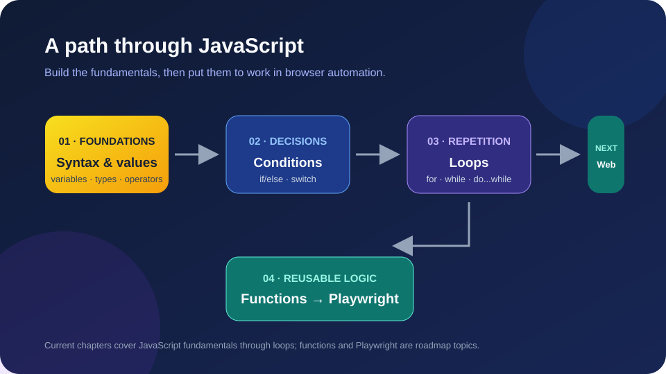
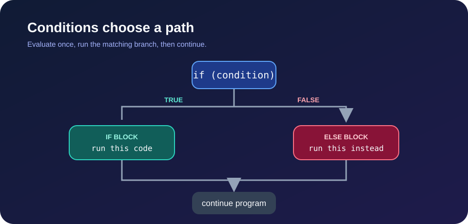
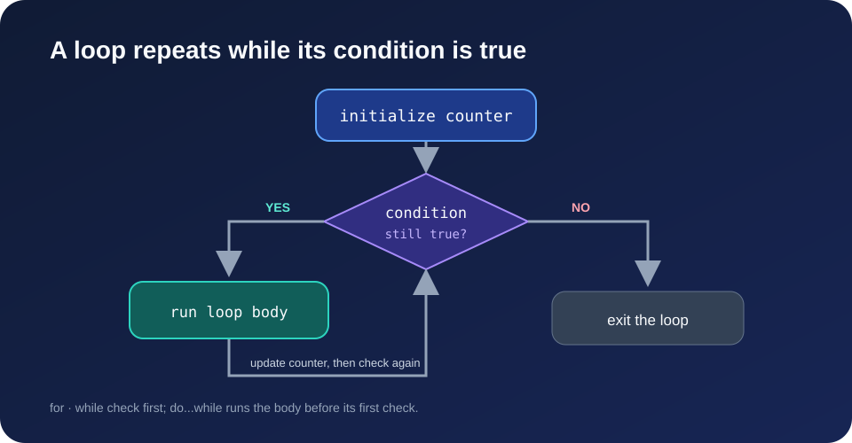
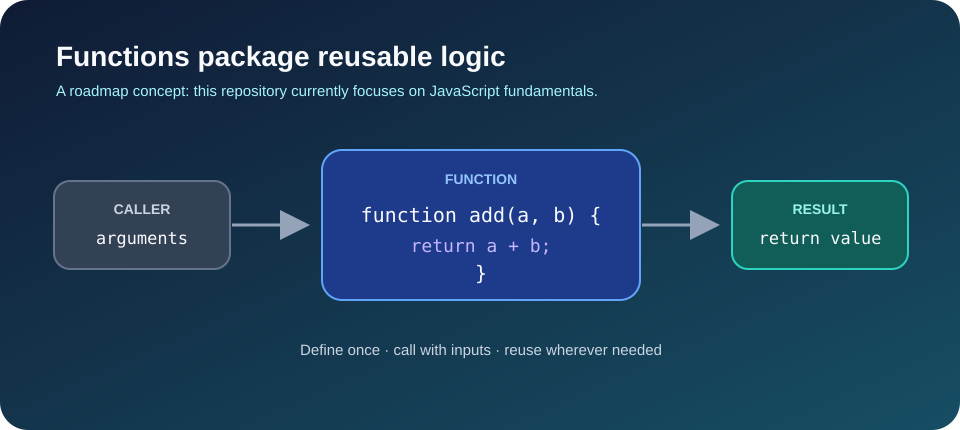
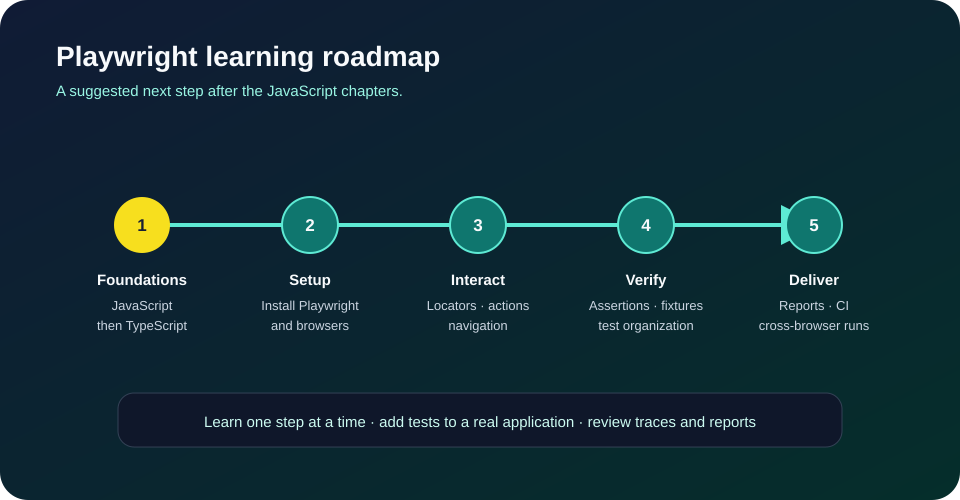

# Learning JavaScript & Playwright

A hands-on learning project for building JavaScript fundamentals and progressing toward browser automation with Playwright and TypeScript. The repository is organized as numbered chapters with small, runnable examples and practice questions.

<p align="center">
  
</p>

## Table of Contents

- [Project Overview](#project-overview)
- [Chapter-by-Chapter Learning Guide](#chapter-by-chapter-learning-guide)
- [JavaScript Examples](#javascript-examples)
- [Concept Diagrams](#concept-diagrams)
- [Playwright Learning Roadmap](#playwright-learning-roadmap)
- [Getting Started](#getting-started)
- [Project Structure](#project-structure)

## Project Overview

Start with JavaScript syntax, values, and operators; then practice conditions, switch statements, and loops. Prompt-engineering and QA materials provide a testing perspective. The diagrams on this page illustrate key concepts and a suggested path from language fundamentals to Playwright.

| Area | What you will learn |
| --- | --- |
| JavaScript fundamentals | Runtime basics, identifiers, values, operators, input, and control flow |
| Practice | Short examples and questions grouped into numbered chapters |
| QA foundations | RICEPOT prompt engineering, problem statements, and anti-hallucination techniques |
| Next step | A learning roadmap for functions, TypeScript, and Playwright browser testing |

## Chapter-by-Chapter Learning Guide

| Chapter | Learning topics | Start here |
| --- | --- | --- |
| [00 · Prompt Engineering](00_Chapter_Prompt_Eng/Selenium_Framework/) | RICEPOT framework, prompts, problem statements, anti-hallucination strategies, and a reusable QA template | [Generic QA template](00_Chapter_Prompt_Eng/Selenium_Framework/04_RICEPOT_Generic_QA_Template.md) |
| [01 · JavaScript Basics](01_Chapter_JS_Basics/) | Hello World and arithmetic | [Hello World](01_Chapter_JS_Basics/01_HelloWorld.js) |
| [02 · Keywords & Identifiers](02_Chapter_JS_Keywords_Identifiers/) | JavaScript engine, declarations, keywords, naming rules, and comments | [Identifier rules](02_Chapter_JS_Keywords_Identifiers/06_keyword_identifier_rules.js) |
| [03 · Literals](03_Chapter_JS_Literals/) | Numbers, booleans, strings, null, undefined, BigInt, and special numeric values | [Special numeric values](03_Chapter_JS_Literals/17_Special_Numeric_Values.js) |
| [04 · Operators](04_Chapter_JS_Operators/) | Assignment, arithmetic, comparison, logical, string, ternary, and `typeof` operators | [Arithmetic operators](04_Chapter_JS_Operators/21_Arithmetic_Op.js) |
| [05 · Increment & Decrement](05_Chapter_JS_Increment%26Decrement_Operators/) | Prefix and postfix updates, nullish coalescing, and practice questions | [Nullish coalescing](05_Chapter_JS_Increment%26Decrement_Operators/45_Nullish_Coalescing.js) |
| [06 · If / Else Conditions](06_Chapter_If_Else_Statement_Condition/) | `if`, `if/else`, nested branches, and multiple conditions | [Nested conditions](06_Chapter_If_Else_Statement_Condition/47_If_Else_Nested.js) |
| [07 · Switch](07_Chapter_Switch/) | `switch`, grouped cases, and practical decision-making examples | [API status switch](07_Chapter_Switch/53_API_Switch.js) |
| [08 · User Input](08_Chapter_JS_UserInput/) | Browser prompts, Node.js readline, synchronous prompts, and standard input | [Read standard input](08_Chapter_JS_UserInput/62_FS_readfile.js) |
| [09 · For Loops](09_Chapter_Loops/) | Repetition, loop initialization/condition/update, and practice questions | [For loop](09_Chapter_Loops/64_For_Loop.js) |
| [10 · While Loops](10_Chapter_While_Loop/) | Condition-first loops, counters, and breaking out of a loop | [While loop](10_Chapter_While_Loop/70_ICU.js) |
| [11 · Do…While Loops](11_Chapter__Do_While_Loop/) | Body-first repetition, nested loops, and comparison with `while` | [Do…while vs. while](11_Chapter__Do_While_Loop/75.IQ.js) |

## JavaScript Examples

Run an individual example from the repository root with Node.js:

```sh
node 01_Chapter_JS_Basics/01_HelloWorld.js
node 04_Chapter_JS_Operators/21_Arithmetic_Op.js
node 06_Chapter_If_Else_Statement_Condition/47_If_Else_Nested.js
node 09_Chapter_Loops/64_For_Loop.js
node 10_Chapter_While_Loop/70_ICU.js
node 11_Chapter__Do_While_Loop/75.IQ.js
```

Each file is a standalone example. Some files in the user-input chapter wait for terminal input; `59_UI.js` uses the browser's `prompt()` API, and `61_Prompt_Sync.js` requires the separate `prompt-sync` package.

## Concept Diagrams

### Conditions

An `if/else` statement selects a branch based on a condition, then rejoins the normal program flow.

<p align="center">
  
</p>

### Loops

A `for` or `while` loop checks its condition before each iteration. A `do...while` loop runs its body once before its first check.

<p align="center">
  
</p>

### Functions

Functions group reusable logic behind parameters and can return a value. This is a preview concept for a future learning step; a functions chapter is not currently included in the repository.

<p align="center">
  
</p>

## Playwright Learning Roadmap

Playwright is a roadmap goal, not an implemented test suite in this repository yet. After practicing the JavaScript chapters, progress through TypeScript and the steps below:

1. **Prepare:** Learn TypeScript basics and install Playwright with its supported test runner.
2. **Set up:** Create a test project and install the browsers needed for your tests.
3. **Interact:** Practice pages, locators, actions, navigation, and resilient selectors.
4. **Verify:** Add web-first assertions, fixtures, reusable setup, and organized tests.
5. **Deliver:** Review reports and traces, configure cross-browser projects, and run tests in continuous integration.

<p align="center">
  
</p>

For current installation and API guidance, see the [official Playwright documentation](https://playwright.dev/docs/intro).

## Getting Started

1. Install [Node.js](https://nodejs.org/).
2. Clone this repository and open a terminal in its root folder.
3. Run one of the examples above with `node`.
4. Follow the chapters in order, experimenting with the examples as you go.

No package installation is needed for the standalone JavaScript examples, except `61_Prompt_Sync.js`, which imports `prompt-sync`.

## Project Structure

```text
.
|-- .gitignore
|-- README.md
|-- assets/
|   `-- images/
|       |-- condition-flow.svg
|       |-- function-anatomy.svg
|       |-- javascript-learning-map.svg
|       |-- loop-flow.svg
|       `-- playwright-roadmap.svg
|-- 00_Chapter_Prompt_Eng/
|   `-- Selenium_Framework/
|       |-- 00_RICEPOT_Fullform.md
|       |-- 01_RICEPOT_Prompt.md
|       |-- 02_Problem_Statement.md
|       |-- 03_Anti_Hallucination.md
|       `-- 04_RICEPOT_Generic_QA_Template.md
|-- 01_Chapter_JS_Basics/
|   |-- 01_HelloWorld.js
|   `-- 02_Math.js
|-- 02_Chapter_JS_Keywords_Identifiers/
|   |-- 03_js_engine.js
|   |-- 04_let_engine.js
|   |-- 05_Keyword_Identifier.js
|   |-- 06_keyword_identifier_rules.js
|   |-- 07_Identifier_Rules.js
|   |-- 08_Comments.js
|   `-- 09_IQ.js
|-- 03_Chapter_JS_Literals/
|   |-- 10_Literal.js
|   |-- 11_Numberal.js
|   |-- 12_Null_Undefined.js
|   |-- 13_Null.js
|   |-- 14.Literals.js
|   |-- 15_Number_Part01.js
|   |-- 16_Number_Part02.js
|   |-- 17_Special_Numeric_Values.js
|   `-- 18_Undefined.js
|-- 04_Chapter_JS_Operators/
|   |-- 19_Arch.js
|   |-- 20_Assignment_Op.js
|   |-- 21_Arithmetic_Op.js
|   |-- 22_Comparison_Op.js
|   |-- 23_Logical_Op.js
|   |-- 24_Confusing_Comparison_Op.js
|   |-- 25_CC.js
|   |-- 26_Questions.js
|   |-- 27_String.js
|   |-- 28_Ternary_Op.js
|   |-- 29_Ternary_Operator.js
|   |-- 30_IQ.js
|   |-- 31_IQ.js
|   |-- 32_IQ.js
|   |-- 33_IQ.js
|   |-- 34_Nested_Ternary.js
|   |-- 35_IQ.js
|   |-- 36_IQ.js
|   `-- 37_TypeOf.js
|-- 05_Chapter_JS_Increment&Decrement_Operators/
|   |-- 38_ID_Pre_Increment.js
|   |-- 39_ID_Post_Increment.js
|   |-- 40_IQ.js
|   |-- 41_IQ.js
|   |-- 42_IQ.js
|   |-- 43_Decrement.js
|   |-- 44_DE.js
|   `-- 45_Nullish_Coalescing.js
|-- 06_Chapter_If_Else_Statement_Condition/
|   |-- 46_IF.js
|   |-- 47_If_Else_Nested.js
|   |-- 48_Ternary_Op_If_Else.js
|   `-- 49.Multiple_If_Else.js
|-- 07_Chapter_Switch/
|   |-- 50_Switch.js
|   |-- 51_IQ.js
|   |-- 52_IQ.js
|   |-- 53_API_Switch.js
|   |-- 54_Switch_Group.js
|   |-- 55_IQ.js
|   |-- 56_IQ.js
|   |-- 57_IQ.js
|   `-- 58_IQ.js
|-- 08_Chapter_JS_UserInput/
|   |-- 59_UI.js
|   |-- 60_Node_UI.js
|   |-- 61_Prompt_Sync.js
|   `-- 62_FS_readfile.js
|-- 09_Chapter_Loops/
|   |-- 63_Loop.js
|   |-- 64_For_Loop.js
|   |-- 65_For_Loop_.js
|   |-- 66_IQ.js
|   |-- 67_IQ.js
|   |-- 68_IQ.js
|   `-- 69_IQ.js
|-- 10_Chapter_While_Loop/
|   |-- 70_ICU.js
|   |-- 71_IQ.js
|   |-- 72_IQ.js
|   `-- 73_IQ_Break.js
`-- 11_Chapter__Do_While_Loop/
    |-- 74_IQ.js
    |-- 75.IQ.js
    |-- 76_Nested.js
    `-- 77_IQ.js
```
